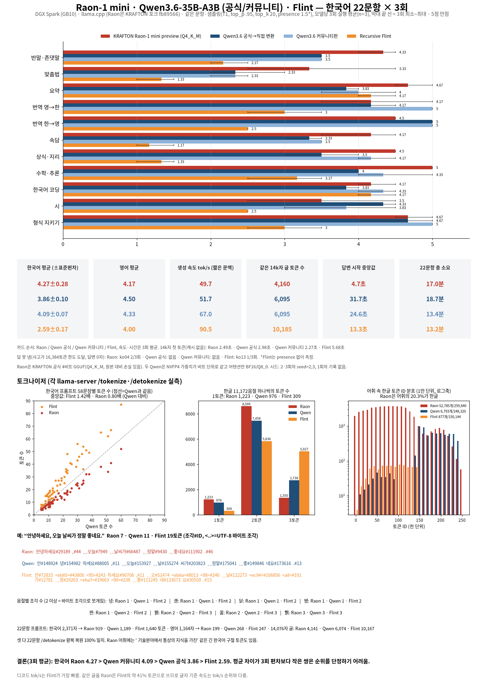

# Raon-1 mini vs Qwen3.6-35B-A3B (공식 직접 변환 / 커뮤니티판) vs Flint — 한국어 22문항 × 3회 + 같은 벤치 (DGX Spark GB10, 2026-10-22~23 KST)

**모든 점수와 속도는 모델마다 3회 실행 평균(n=3)입니다.** 1회차는 2026-10-22 실행(seed 기록 없음, 서버 기본값=무작위), 2·3회차는 2026-10-22~23 같은 서버 바이너리·플래그·샘플링에 seed=2, 3을 지정해 실행. 한 번에 모델 하나만 메모리에 올림(systemd-run MemoryMax, 스왑 0).

채점: 문항별 답변을 같은 기준(1-5점, 0.5 단위)으로 한 명(Grok Bot)이 채점. 회차별 근거는 `results/<모델>/grading.md`. 원자료 `results/<모델>/run{1,2,3}/results.jsonl`, 집계 `results/aggregate.json`.

## 설정
| | Raon-1 mini preview | Qwen3.6 공식 → 직접 변환 | Qwen3.6 커뮤니티판 | Flint |
|---|---|---|---|---|
| 체크포인트 | KRAFTON/Raon-1-mini-preview-gguf rev 3afcfcdb, Q4_K_M 19.69GB (SHA256SUMS 일치). 28.8B / 4.3B active, Apache-2.0, 10/21 공개 | nvidia/Qwen3.6-35B-A3B-NVFP4 rev 1355db6a → convert_hf_to_gguf.py --outtype bf16, 23.85GB | williamliao/Qwen3.6-35B-A3B-NVFP4-GGUF 22.7GB | RecursiveSI/flint-nvfp4-gguf 22.9GB |
| 정밀도 | 공식 4비트 양자화(Q4_K 51·Q6_K 143·Q5_0 12·Q8_0 82·F16 122 텐서), BF16 대비 **손실 있음** | NVFP4 그대로 + 어텐션 BF16 | NVFP4 + 어텐션 Q8_0 | NVFP4(QAT) |
| llama.cpp | KRAFTON 포크 krafton-ai/llama.cpp branch raon-1-mini-preview, 커밋 fb895662 (2026-10-20 22:33 KST), (로컬 빌드) | ggml-org 7170cad | 7170cad | 7170cad |
| 서버 | llama-server -c 32768 -np 1 -fa on f16 KV --jinja(GGUF 내장 템플릿), 127.0.0.1:8083 | 같은 플래그, :8082 | :8081 | :8080 |
| 샘플링 | T1.0 top_p .95 top_k 20 min_p 0 presence 1.5 (KRAFTON 권장 일반 설정과 같음) | 같음 | 같음 | T1.0 top_p .95 top_k 20 |
| 벤치 중 다른 모델 | 없음 | 없음 | 없음 | 없음 |

2·3회차는 요청마다 `seed`를 지정(`eval_extra.json`에 기록). Flint는 presence penalty 없음(원래 설정 그대로).

## 변환 무손실 검증 (공식판)
| 구분 | 원본 dtype | GGUF 타입 | 결과 |
|---|---|---|---|
| 라우팅 전문가 gate/up/down (40층×256×3) + 공유 전문가 (40×3) + lm_head | NVFP4: U8(E2M1 2개/바이트) + F8_E4M3 16개 블록 스케일 + F32 weight_scale_2 | NVFP4 (64개 슈퍼블록 = UE4M3 스케일 4개 + 32바이트) + F32 `.scale` 텐서 | **30,841개 전부 비트 단위 동일** (독립 재구현한 재배치와 GGUF 바이트 비교). 블록 스케일 부호 비트·NaN(0x7F) 0개라 부호 비트 제거로 잃는 것 없음. 역양자화 비교 37개(전문가 27·공유 9·lm_head) max abs diff = 0 |
| weight_scale_2 (텐서별 글로벌 스케일) | F32 스칼라 (전문가마다 하나) | 층별 `ffn_*_exps.scale` F32 [256], 공유·lm_head는 F32 [1] | 전부 F32 값 그대로 (30,841개 비교), 추론 때 ggml_mul로 곱함 |
| input_scale | F32 | F32 `.input_scale` (W4A16이라 추론에 안 씀) | 그대로 저장 |
| token_embd, mtp.fc, linear_attn in_proj_a/b | BF16 | BF16 | 비트 동일 (in_proj_a/b는 V-head 재배치라 값 집합 비교) |
| 라우터 gate, shared_expert_gate, conv1d, 노름 | BF16 | F32 (변환기 규칙, 업캐스트) | 값 동일 (max abs diff 0) |
| 어텐션 q/k/v/o, linear_attn qkv/z/out (FP8 원본) | F8_E4M3 + F32 텐서별 스케일 | BF16 | **무손실 아님**: FP8×스케일(F32 계산)을 BF16으로 반올림. 14개 텐서에서 BF16 반올림 결과와 정확히 일치, 최대 상대오차 0.37%, 최대 절대오차 0.0017. 커뮤니티판 Q8_0은 같은 텐서에서 RMSE 3~5배 큼 |
| BF16 → F16 강등 | | | **없음** (GGUF에 F16 텐서 0개) |
| 커뮤니티판과 비교 | | | NVFP4 텐서 241개 바이트 동일, 어휘·병합표·토큰타입·채팅 템플릿 해시 동일. 차이는 FP8 어텐션 처리(BF16 vs Q8_0)뿐 |

## 카테고리 점수 (1-5, 3회 평균, 괄호는 최소~최대)
| 카테고리 | Raon Q4_K_M | Qwen 공식 직접 변환 | Qwen 커뮤니티 | Flint |
|---|---|---|---|---|
| 반말/존댓말·대화 | 4.33 (4~4.5) | 3.50 (3.5~3.5) | 3.50 (3.5~3.5) | 2.17 (2~2.5) |
| 맞춤법/문법 | 3.33 (2.5~4.5) | 2.33 (2~3) | 2.33 (2~2.5) | 1.33 (1~1.5) |
| 요약 | 4.67 (4.5~5) | 3.83 (3.5~4) | 4.00 (3.5~4.5) | 4.17 (4~4.5) |
| 번역 EN→KO | 4.17 (3.5~5) | 4.17 (4~4.5) | 5.00 (5~5) | 3.00 (2.5~3.5) |
| 번역 KO→EN | 4.50 (4.5~4.5) | 5.00 (5~5) | 5.00 (5~5) | 2.50 (2.5~2.5) |
| 속담/관용어 | 4.17 (3.5~4.5) | 3.33 (3~3.5) | 3.50 (3.5~3.5) | 1.17 (1~1.5) |
| 문화/지리 사실 | 4.50 (4.5~4.5) | 3.50 (3~4) | 4.17 (4~4.5) | 1.33 (1~1.5) |
| 추론/수학 | 5.00 (5~5) | 4.00 (4~4) | 4.33 (4~5) | 3.17 (2.5~3.5) |
| 코딩(한국어) | 4.17 (4~4.5) | 3.83 (3.5~4) | 4.33 (4~4.5) | 4.17 (4~4.5) |
| 창작 시 | 3.50 (2.5~4.5) | 4.33 (4~4.5) | 3.83 (3~4.5) | 2.50 (2.5~2.5) |
| 지시 따르기/형식 | 4.67 (4.5~5) | 4.67 (4~5) | 5.00 (5~5) | 3.00 (2.5~3.5) |
| **한국어 평균 (11개)** | **4.27** ± 0.28 | **3.86** ± 0.10 | **4.09** ± 0.07 | **2.59** ± 0.17 |
| 한국어 평균, 회차별 | 4.23 / 4.64 / 3.95 | 3.73 / 3.95 / 3.91 | 4.00 / 4.18 / 4.09 | 2.55 / 2.82 / 2.41 |
| **EN 비교** | **4.17** (4.5 / 4 / 4) | **4.50** (4.5 / 4.5 / 4.5) | **4.33** (4.5 / 4.5 / 4) | **4.00** (4.5 / 3.5 / 4) |

± 는 회차별 한국어 평균의 표준편차(모표준편차, n=3). 1회차 한국어 평균은 이전 보고의 반올림값(Raon ≈4.3 "47/11", Flint ≈2.4) 대신 실제 합계로 다시 계산: Raon 46.5/11 = 4.23, Flint 28/11 = 2.55.

## 문항별 실패 (finish=length 또는 빈 답변, 3회 중)
| 모델 | 실패 |
|---|---|
| Raon Q4_K_M | ko04_spelling 2/3 (회차 1,3) |
| Qwen 공식 직접 변환 | 없음 (0/66) |
| Qwen 커뮤니티 | 없음 (0/66) |
| Flint | ko13_logic 1/3 (회차 3) |

답변 본문 속 한자·가나 글자 수 (자동 집계, 회차별): Raon Q4_K_M 0/0/0; Qwen 공식 직접 변환 9/13/17; Qwen 커뮤니티 9/8/2; Flint 0/2/0

## 속도 (3회 평균, 괄호는 최소–최대)
| 항목 | Raon Q4_K_M | Qwen 공식 직접 변환 | Qwen 커뮤니티 | Flint |
|---|---|---|---|---|
| 디코드, 짧은 문맥 (tok/s) | 49.7 (49.5–50.0) | 51.7 (51.2–52.1) | 67.0 (66.3–67.7) | 90.5 (89.4–92.0) |
| 디코드, 긴 생성 (tok/s) | 49.9 (49.7–50.1) | 51.2 (51.1–51.4) | 66.8 (66.3–67.1) | 85.8 (85.4–86.2) |
| 디코드, 긴 문맥 (tok/s) | 49.0 (48.8–49.3) | 50.6 (50.3–51.0) | 65.6 (65.1–66.0) | 77.4 (76.6–78.1) |
| TTFT 짧은 프롬프트 (s) | 0.067 (0.064–0.070) | 0.068 (0.064–0.075) | 0.064 (0.058–0.073) | 0.058 (0.053–0.063) |
| TTFT 긴 프롬프트, 캐시 없음 (s) | 2.49 (2.49–2.50) | 2.98 (2.93–3.03) | 2.27 (2.26–2.28) | 5.68 (5.68–5.68) |
| prefill (tok/s) | 1700 (1693–1707) | 2086 (2051–2122) | 2748 (2742–2754) | 1810 (1810–1811) |
| TTFT 긴 프롬프트, 캐시 (s) | 0.073 (0.070–0.077) | 0.064 (0.062–0.065) | 0.059 (0.055–0.062) | 0.083 (0.078–0.092) |
| 22문항 생성 토큰 합 | 49694 (38396–57038) | 57522 (49935–63496) | 53400 (49431–56181) | 65531 (63051–69453) |
| 생성 토큰 중앙값 | 382 (348–437) | 1931 (1898–1951) | 2041 (1910–2136) | 1539 (1304–1697) |
| 답변 시작까지 중앙값 (s) | 4.7 (4.4–5.0) | 31.7 (30.0–33.7) | 24.6 (21.8–27.3) | 13.3 (10.7–15.3) |
| 답변 시작까지 최대 (s) | 296 (211–340) | 129 (115–146) | 90 (77–100) | 156 (123–212) |
| 22문항 총 소요 (분) | 17.0 (13.1–19.6) | 18.7 (16.2–20.6) | 13.4 (12.4–14.1) | 13.2 (12.7–14.2) |
| 14,076자 글 프롬프트 토큰 수 | 4,160 | 6,095 | 6,095 | 10,185 |

캐시 없는 긴 프롬프트 TTFT·prefill은 서버를 새로 띄운 회차만 평균(n=2: 1·2회차). 3회차는 2회차와 같은 서버라 같은 프롬프트가 프롬프트 캐시에 맞아 콜드 측정이 아님. 답변 시작까지 시간은 답을 못 낸 문항은 전체 소요로 계산.

## 토크나이저 (llama-server /tokenize with_pieces, /detokenize 실측)
| 항목 | Raon | Qwen3.6 (공식=커뮤니티) | Flint |
|---|---|---|---|
| 어휘 크기 / 방식 | 259,840 / BPE(gpt2) | 248,320 / BPE | 150,144 / BPE |
| 한글 들어간 토큰 | 52,785개 (20.31%) | 6,793개 (2.74%) | 877개 (0.58%) |
| 11,172 음절 중 1토큰 / 2토큰 / 3토큰 | 1,223 / 8,599 / 1,350 | 976 / 7,458 / 2,738 | 309 / 5,836 / 5,027 |
| 22문항 한국어 프롬프트(2,371자) | 919 토큰 | 1,189 | 1,640 |
| 문장 58개별 토큰 수, Qwen 대비 중앙값 | 0.80배 | 1 | 1.42배 |
| 영어 프롬프트(1,164자) | 199 | 268 | 247 |
| 14,076자 한국어 글(템플릿 없이) | 4,141 | 6,074 | 10,167 |
| 프롬프트 한글 음절 1,290회 중 1토큰 음절 비율 | 99.6% | 99.6% | 87.8% |
| 한글 토큰 ID 분포 | 0~15만에 걸쳐 1만 구간마다 약 2,000~3,700개, 15만~25만에도 수백 개씩 | 14만~25만 구간에 몰림 | 0.75만~15만에 고르게 |
| 가장 긴 한글 토큰 예 | " 기술분야에서 통상의 지식을 가진"#224439, " 당기손익으로 인식하고 있습니다" | "트립어드바이저", " 더불어민주당" | " 없습니다", "해주세요" |
| /detokenize 왕복 복원 | 22/22 | 22/22 | 22/22 |
예: "안녕하세요, 오늘 날씨가 정말 좋네요." Raon 7토큰(안녕하세요#29189 ,#44 ␣오늘#7949 ␣날씨가#66487 ␣정말#9430 ␣좋네요#111902 .#46), Qwen 11토큰, Flint 19토큰.
바이트 조각 예: 녕·괜·닭·됐 = Raon 1 · Qwen 1 · Flint 2 / 짠 = Raon 1 · Qwen 2 · Flint 2 / 뷁 = Raon 2 · Qwen 2 · Flint 3 / 쀍·똠 = 셋 다 3바이트.
원자료: `tokenizer/`

## 결론 (3회 평균 기준)
- 한국어 22문항(11개 카테고리): Raon Q4_K_M 4.27±0.28 > Qwen 커뮤니티 4.09±0.07 > Qwen 공식 직접 변환 3.86±0.10 > Flint 2.59±0.17. 영어: Raon Q4_K_M 4.17, Qwen 공식 직접 변환 4.50, Qwen 커뮤니티 4.33, Flint 4.00.
- 디코드 tok/s(짧은 문맥): Flint 90.5, Qwen 커뮤니티 67.0, Qwen 공식 직접 변환 51.7, Raon Q4_K_M 49.7.
- Raon은 한국어를 가장 적은 토큰으로 쓰고(14k자 글: Qwen의 약 0.68배, Flint의 약 0.41배) 생각을 짧게 하고 답함. 4비트 양자화본이라 원본 대비 손실 있음.
- Raon은 평균 1위지만 회차 편차가 가장 큼(3.95~4.64). ko04 맞춤법 문항에서 3회 중 2회 사고 루프로 16,384토큰 한도에 걸려 답을 못 냄. 2회차만 보면 4.64, 루프 회차는 4.23·3.95. Qwen 커뮤니티(4.00~4.18)와 범위가 겹침.
- Qwen 공식 직접 변환은 NVFP4 부분이 비트 단위 무손실, 어텐션(FP8 원본)만 BF16 반올림. 그런데도 한국어 점수는 3회 모두 커뮤니티판(어텐션 Q8_0)보다 조금 낮음(평균 차 0.23점). 같은 가중치라 정밀도보다는 샘플링 편차와 채점 오차로 보는 게 맞고, 22문항×3회로는 차이를 단정할 수 없음.
- 두 Qwen은 '미역국을 먹다'와 사투리를 3회 모두 틀리고 답변에 한자가 섞임. Flint는 맞춤법·속담·사실 문항에서 3회 모두 약함.

## 한계
- 22문항 × 3회, 채점자 1명(주관적). 0.2~0.3점 차이는 표본 편차 범위일 수 있음.
- 1회차 seed는 기록되지 않음. Raon은 공식 Q4_K_M(손실 있음), Qwen·Flint는 NVFP4.
